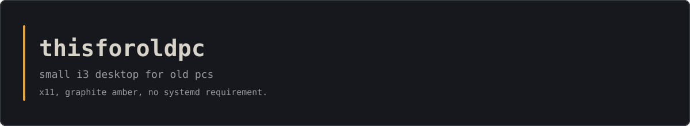

# ThisForOldPc

installs a small i3 desktop for old pcs such as the thinkcentre m58, with configs for i3, neovim, alacritty, thunar, picom and gtk.

[read the quick start](#quick-start)

| | |
| --- | --- |
| **package managers** | detects apt, dnf, pacman or zypper before installing anything. |
| **install** | `bash install.sh` runs as a normal user. package commands escalate with sudo, or doas when sudo is absent. |
| **configs** | files land in `$XDG_CONFIG_HOME`, with a timestamped backup of each file replaced. |
| **rerun** | the script checks installed packages and can run again after a config change. |

## Quick start

```bash
git clone https://github.com/SOSMLG/ThisForOldPc.git
cd ThisForOldPc
bash install.sh
```

Run as a normal user, not root. The installer escalates individual package
commands with sudo, or doas when sudo is absent. Set `TFOP_PRIV=doas` to force
one helper. Log out after the run and choose the i3 session.

## What it does

- Detects `apt`, `dnf`, `pacman` or `zypper`, then installs Xorg, i3, i3status,
  i3lock, dmenu, xterm, Thunar, Alacritty, Firefox, feh and Neovim.
- Installs picom only when `lspci` reports a usable GPU.
- Attempts zram-generator and TLP when the release provides them.
- Copies configs into `$XDG_CONFIG_HOME` (default `~/.config`), keeping a
  timestamped backup of each file it replaces.

The script is idempotent: it checks installed packages before calling the
package manager and can be run again after a config change.

## Options

The installer has no positional arguments. It honors these environment
variables:

| Variable | Meaning |
|---|---|
| `TFOP_PRIV` | Force `sudo` or `doas` as the privilege helper. |
| `TFOP_SKIP_APT_UPDATE=1` | Skip `apt-get update` on apt systems. |
| `XDG_CONFIG_HOME` | Override the config destination. |

## Verification

```bash
bash verify.sh
```

The verifier is read-only. It checks the installer, the deployed configs and
the main executables. It prints `PASS`, `WARN` or `FAIL` and exits nonzero only
when a required repo file is missing.

## Layout

```
install.sh              main installer
verify.sh                  read-only end-state verifier
configs/i3/config          i3 window manager config
configs/nvim/init.lua      Neovim config
configs/alacritty/         Alacritty terminal config
configs/thunar/uca.xml     Thunar custom actions
configs/picom/picom.conf   optional compositor config
configs/gtk-3.0/settings.ini GTK dark settings
AGENTS.md                  project conventions
```

## License

MIT. See [LICENSE](LICENSE).

## Related repos

- [DebianSway](https://github.com/SOSMLG/DebianSway): Sway on Debian/Devuan.
- [DevuanSway](https://github.com/SOSMLG/DevuanSway): Sway on Devuan with OpenRC.
- [DevuanDwm](https://github.com/SOSMLG/DevuanDwm): minimal dwm desktop for Devuan.
- [Devuan-Kde](https://github.com/SOSMLG/Devuan-Kde): KDE Plasma on Devuan.
- [XfceMlg](https://github.com/SOSMLG/XfceMlg): XFCE desktop toolkit.

## Repository standard

This repo follows the SOSMLG standard: [contributing](CONTRIBUTING.md), [security](SECURITY.md), [changelog](CHANGELOG.md). Local workflow: [English guide](https://github.com/SOSMLG/.github/blob/main/docs/GIT_GUIDE.md) / [Arabic guide](https://github.com/SOSMLG/.github/blob/main/docs/GIT_GUIDE.ar.md). Visual standard: [theme](https://github.com/SOSMLG/.github/blob/main/docs/THEME.md) / [الطابع البصري](https://github.com/SOSMLG/.github/blob/main/docs/THEME.ar.md).
